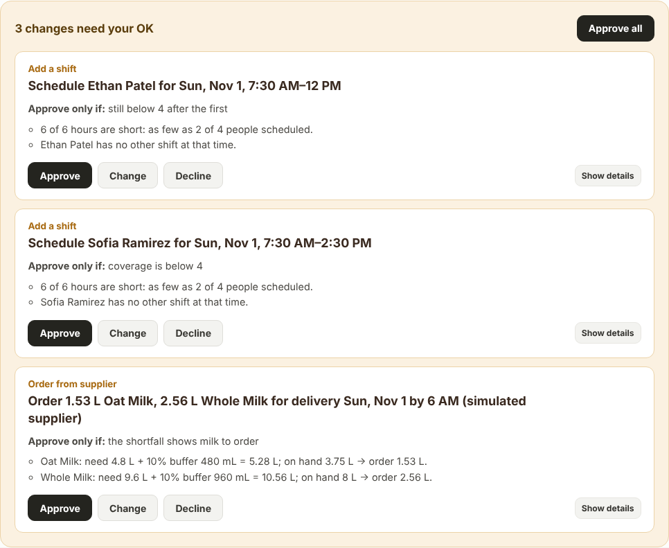
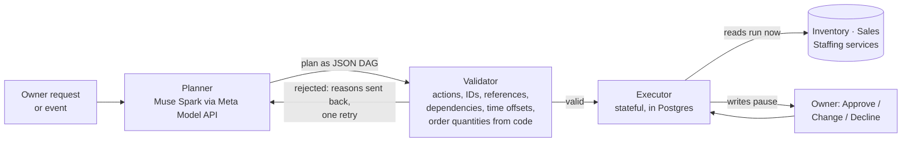

# CaféPilot

AI operations assistant for independent cafés, built for the Meta Global AI Developer Hackathon.
The owner describes what's coming up ("farmers market this Sunday"); Muse Spark plans the work, code
checks and runs it, and nothing in the café changes until the owner approves.

> **The model proposes, the code decides.** Muse writes the plan. Code validates every step, does all
> the arithmetic, runs the lookups, and pauses every change for the owner's OK.



## How it works



- **Action registry** (`backend/modules/agent/registry.py`): 19 typed actions over the existing
  Inventory, Sales and Staffing services. The model can only use these; `create_sale` and
  `create_employee` are deliberately not exposed.
- **Superset DAG** (`superset.py`): which action may feed which (data edges) and which must come first
  (safety edges, e.g. coverage + staff + existing shifts before scheduling a shift). Checked for cycles
  at startup.
- **Validator** (`validator.py`): rejects unknown actions or IDs, bad arguments, broken `$step.field`
  references, missing prerequisites, another café, wrong UTC offsets for the date (daylight saving),
  supplier orders whose quantities didn't come from `calculate_shortfall`, and staffing checks that
  don't cover the shift being added.
- **Order math in code** (`calculations.py`): need (recipes × expected mix) + buffer (café policy)
  − stock on hand = order. Unknown stock is reported, never guessed; a missing recipe blocks the order.
- **Executor** (`executor.py`): reads run immediately; writes wait at `awaiting_approval`; approval is
  checked again before any write; stable record IDs mean a retry or crash can't create a duplicate;
  replaying a plan never repeats a completed write; owner edits are re-validated and audited.

## Quick start

Requirements: Docker, Python 3.13, Node 22.

```bash
cd business-core
cp .env.example .env            # set POSTGRES_PASSWORD and MODEL_API_KEY
docker compose up -d            # Postgres on 127.0.0.1:5433
python -m venv .venv && source .venv/bin/activate
pip install -r requirements.txt
./scripts/seed_all.sh           # migrations + demo café data
PYTHONPATH=. python scripts/seed_event_surge.py --fresh   # Sunday farmers-market scenario
# add --with-delivery for the receiving demo (PO-1042 from Willow Ridge, arriving Sun 5:30 AM)
uvicorn backend.main:app --port 8001 --reload
```

In a second terminal:

```bash
cd business-core/frontend
npm install
npm run dev                     # http://localhost:5173/agent
```

Open **Ask CaféPilot** and click **Check if we're ready** on the Santa Clara Farmers Market.

Reset before each demo: `PYTHONPATH=. python scripts/seed_event_surge.py --fresh`
(removes the agent's runs and the changes they made, then reloads the scenario).

## Tests

```bash
cd business-core && python -m pytest -q          # needs the Postgres container
cd business-core/frontend && npm test && npx tsc --noEmit
```

CI runs both on every push and pull request (`.github/workflows/business-core.yml`).

## Repository map

| Path | What it is |
|---|---|
| `business-core/backend` | FastAPI app: Inventory, Sales, Staffing modules and the agent |
| `business-core/frontend` | React app: Ask CaféPilot, Dashboard, Inventory, Sales, Staffing |
| `business-core/alembic` | Database migrations |
| `business-core/scripts` | Seed and demo-scenario scripts |
| `business-core/docs` | Module references, agent build plan, demo scenario, screenshots |
| `development-log/` | Day-by-day decisions and results |
| `backend/`, `data/`, `tests/` (root) | Early JSON-file prototype, kept for history; not used by Business Core |

## Status

Built: business data core, agent registry, planner, validator, executor, approvals with
Approve / Change / Decline, the farmers-market scenario. Next: event trigger and Muse chat UI,
supplier-rejection replanning, multimodal receiving.

Demo data is synthetic. The supplier is simulated: orders are confirmed by a stand-in and never add
stock; inventory only increases when goods are actually received and recorded.
