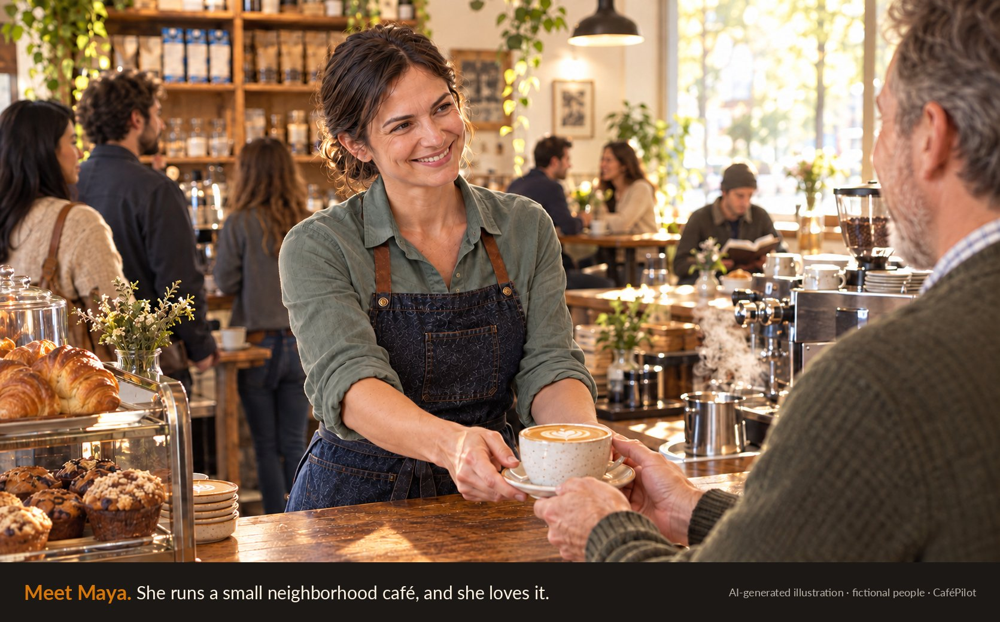
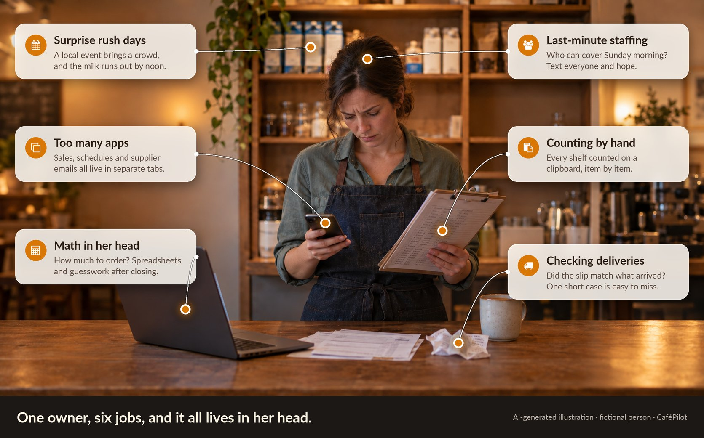
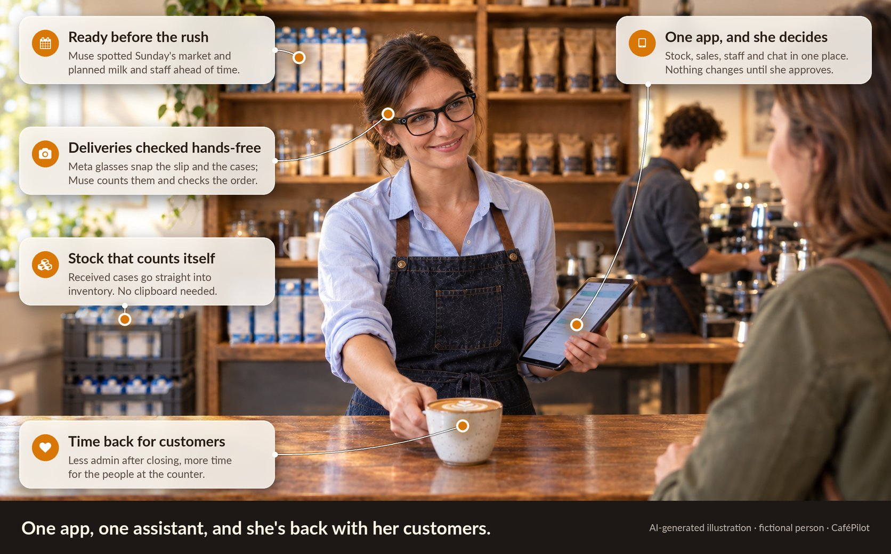
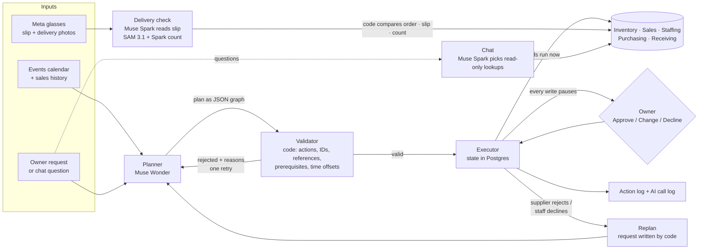
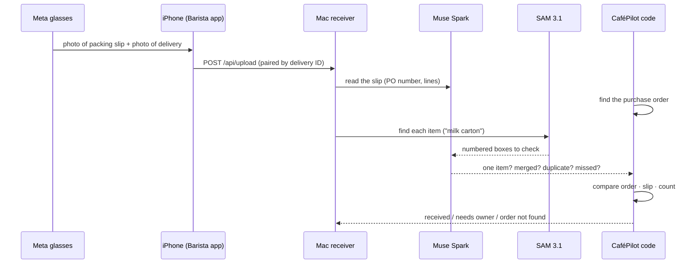
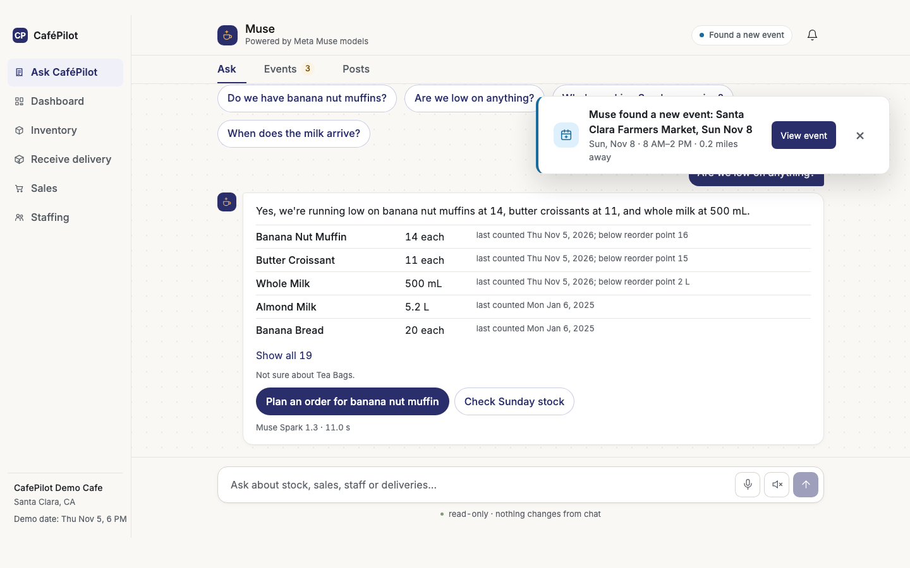
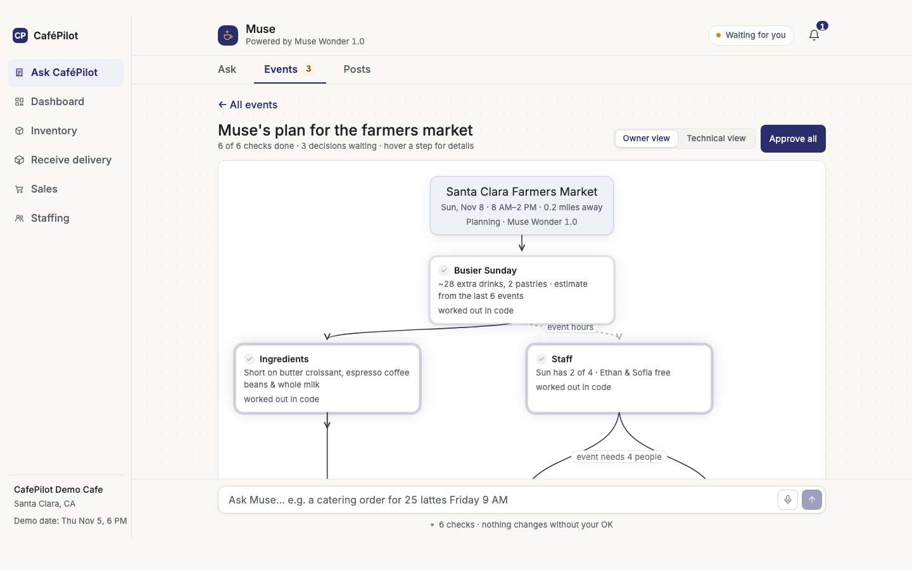
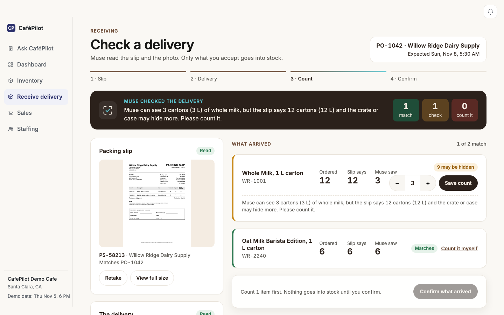
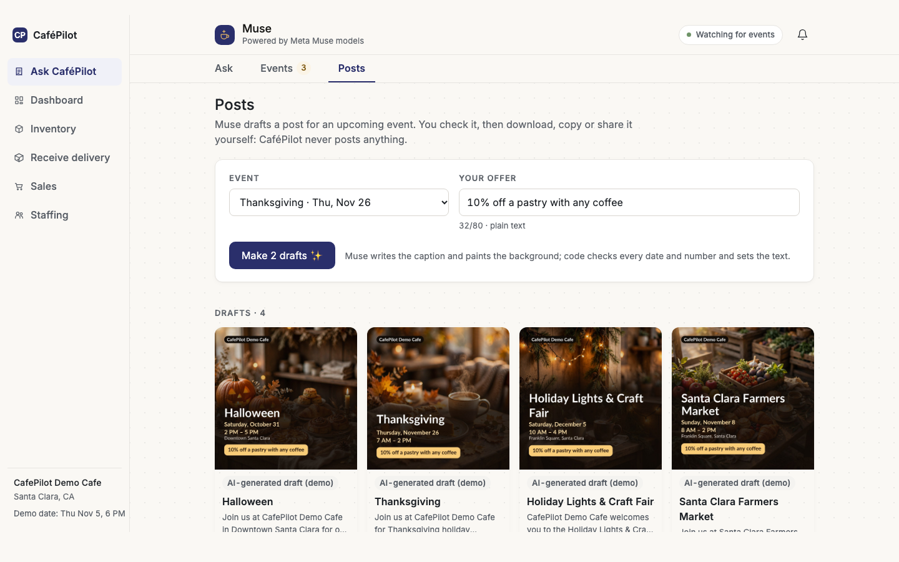

# CaféPilot

**An AI operations assistant for small businesses, built on Meta's Muse models and Meta glasses.**
Muse spots busy days before they happen, plans stock and staff, checks deliveries through Meta
glasses, and answers the owner's questions, and nothing in the business changes until the owner
approves.

▶ [Watch the 3-minute demo](https://www.youtube.com/watch?v=7MMuKQn-kCE) · [How it works](#how-it-works) · [Meta models](#meta-ai-used) · [Run it](#run-it-locally) · [Built during the hackathon](#built-during-the-hackathon)

## Documentation

- [docs/README.md](docs/README.md): start here, with the reading order for all pages
- [Architecture](docs/architecture.md): the big picture, the layers and one request end to end
- [Agentic planning](docs/agentic-planning.md): why a plan graph (DAG), and how the registry, validator, executor and approvals work
- [Forecasting and math](docs/forecasting-and-math.md): every calculation, from demand estimate to pack rounding and delivery counting
- [Mobile app](docs/mobile-app.md): the Barista iPhone app for Meta glasses
- [Limitations and decisions](docs/limitations-and-decisions.md): planned vs built, what is simulated, known limits

Meta Global AI Developer Hackathon · Indie Developer track · Built Oct 26 – Nov 4, 2026 ·
Example business: an independent café · All demo data is synthetic

> **The model proposes. The code checks. The owner decides.**

## Meet Maya



Maya runs a small neighborhood café, and she loves it: the regulars, the morning rush, the perfect
latte. But the moment the doors close, her second job begins.

## The problem



Independent café owners run operations across separate apps, spreadsheets, a clipboard and their
own memory:

| Pain | What actually goes wrong |
|---|---|
| **Fragmented systems** | POS, scheduling, supplier email and spreadsheets share no data, so the owner connects the dots by hand. |
| **Stale inventory** | Stock is counted by hand; between counts, on-hand numbers are guesses. |
| **No event-aware demand** | A farmers market or holiday changes demand, but nothing links the calendar to past sales. |
| **Manual unit math** | Extra drinks → recipes → litres → supplier cases, worked out in her head. |
| **Unverified receiving** | Packing slip vs. purchase order vs. what actually arrived, checked by eye at 6 AM. |
| **No closed loop** | Orders and shift requests go out with no tracking of who confirmed and who didn't. |

## The solution



CaféPilot puts inventory, sales, staffing and suppliers in one system with one assistant, **Muse**:

1. **Plans ahead for busy days.** Muse finds an upcoming event (e.g., the Santa Clara Farmers Market
   on Sunday), estimates the extra demand from past similar days, works out the ingredients from
   recipes, finds staff gaps, and drafts supplier orders and shifts.
2. **Recovers when things go wrong.** If a supplier rejects the order or a barista declines a shift,
   Muse replans (another supplier, another qualified person) and asks again.
3. **Checks deliveries hands-free.** The owner looks at the packing slip and the delivery through
   **Meta glasses**. Muse Spark reads the slip, SAM 3.1 + Muse Spark count the items, and code
   matches everything against the order.
4. **Answers questions.** "Are we low on anything?" Muse picks the right lookups and answers from
   the café's real data, by voice or chat.
5. **Keeps the owner in control.** Every change is a card: **Approve / Change / Decline**. Statuses
   are honest: *Proposed → Approved → Sent → Waiting → Confirmed / Rejected*.

The café is the example. The same pattern fits bakeries, restaurants and any small shop that runs on
stock and shifts.

### In the app

**Ask CaféPilot** has three tabs:

- **Ask** (first; the app opens on it): ask by voice or chat.
- **Events**: **Upcoming** and **Past events**, each with **Let's plan** and **Make a post**. Past
  events (e.g. Halloween) are read-only. In the demo, the Santa Clara Farmers Market appears here
  after your first question in Ask.
- **Posts**: event post drafts (Instagram-style) to check, copy or download.

The sidebar has the rest:

- **Dashboard**: revenue, sales, units sold and the business summary.
- **Inventory**: ingredients, current stock, stock counts and stock movements.
- **Receive delivery**: the delivery check (packing slip, delivery photo, counts, confirm).
- **Sales**: overview (top products, hourly sales), sales history and menu products.
- **Staffing**: employees, shifts and hour-by-hour coverage.

The **Updates bell** in the header collects what happened (supplier replies, accepted or declined
shifts, a newly found event), and its **AI activity** tab is the log of every model call (model,
time taken, outcome).

### Ask by voice or chat

The mic uses the browser's own speech recognition, and the spoken reply is the browser's
text-to-speech (Muse Voice Transcribe is not used). Muse Spark picks read-only lookups (stock,
sales, shifts, deliveries) and writes the answer; every number in it comes from the database, not
the model. Chat can't change anything: a request to change something becomes a plan that waits for
the owner's OK.

## Demo story (what the video shows)

| Step | What happens | Meta AI |
|---|---|---|
| 1. Ask | Maya asks by voice, "Are we low on anything?" Muse answers in one sentence with a table of what's below its reorder point. | Muse Spark |
| 2. Event found | After the first question: "Muse found a new event: Santa Clara Farmers Market, Sun Nov 8" (8 AM–2 PM, 0.2 miles away). **View event** opens it under Upcoming in **Events**. The discovery is scripted in the demo (see [Demo data](#demo-data-timing-and-reset)). | — |
| 3. Plan | Demand estimate from past markets (typically +28 drinks) → whole milk, coffee beans and croissants short, rounded to supplier packs → 2 open staff slots → orders and shifts drafted as a live plan graph. | Muse Wonder |
| 4. Approve | Maya approves the cards; nothing is sent before that. The supplier confirms order **PO-123**; Ethan and Sofia accept their shifts. | — |
| 5. Delivery | Meta glasses photograph the packing slip and the delivery for PO-123; Muse reads the slip, counts what it can see, and flags anything to count before stock is added. The built-in sample order **PO-1042** comes with demo photos for trying the check without glasses. | Muse Spark, SAM 3.1, glasses SDK |
| 6. Posts | An Instagram-style post draft for the event; code checks every date and number. Nothing is ever posted. | Muse Spark, Muse Image |

**Not in the video:** replanning after a supplier rejects an order or a barista declines a shift.
It is implemented (`backend/modules/agent/replanning.py`) and covered by tests in
[`business-core/tests/test_agent_replanning.py`](business-core/tests/test_agent_replanning.py)
(e.g. Bay Dairy is out of oat milk → Muse replans with Willow Ridge). The current demo data
doesn't trigger it: the usual supplier has everything the market needs.

## How it works



### Design rules

- **The model never writes a number.** Demand, ingredient math, case rounding and delivery totals
  are all computed in code (`calculations.py`, `demand.py`, `counting.py`). Unknown stock is
  reported, never guessed.
- **A fixed set of tools.** 23 typed actions over the existing services (`registry.py`); the model
  can only use these. Sensitive ones (`create_sale`, `create_employee`) are not exposed.
- **Validate before anything runs.** Unknown actions or IDs, broken step references, missing
  prerequisites (e.g., checking coverage before scheduling a shift), wrong time offsets around
  daylight saving, and order quantities that didn't come from the shortfall calculation are all
  rejected (`validator.py`).
- **Every write waits for the owner.** Approval is checked again right before the write; stable
  record IDs mean a retry or crash can't create a duplicate; owner edits are re-validated and logged
  (`executor.py`).
- **Honest uncertainty.** If SAM and Spark don't agree on a count, the result is "please count it",
  not "short delivery".

More detail: [docs/agentic-planning.md](docs/agentic-planning.md).

### How demand is estimated

Code estimates an event's extra demand from the sales history (`demand.py`). A normal day is the
average of up to 8 recent same-weekday days without events, for the same hours. Each comparable past
event (for the farmers market, its 6 past editions) is compared with a normal day at its own hours,
which gives one estimate of the extra demand; the middle one is the typical case (about +28 drinks),
and the lowest and highest give the low and high cases. The plan shows the source ("estimate from the
last 6 events"), and with fewer than 3 past events the estimate is marked as a rough guide. It is a
transparent estimate from comparable past days, not a trained forecasting model.

### Delivery check with Meta glasses



### Failure handling

| What goes wrong | What CaféPilot does |
|---|---|
| Plan fails validation | Reasons go back to Muse Wonder for one retry; if it still fails, nothing runs. |
| Supplier rejects an order | Code writes a new request from the facts (who said no, what's still needed, by when); Muse replans with another supplier; the new run is linked to the failed one. |
| Staff member declines a shift | Replan with another qualified employee. |
| Delivery comes up short | The receipt waits for the owner; a reorder can be planned from another supplier. Stock only increases when goods are received. |
| Count is uncertain | Marked "may hide more" → "please count it" instead of a false shortage. |
| Request is ambiguous or conflicting | Muse asks a clarifying question instead of guessing. |
| Model timeout or error | Logged in `ai_calls` with the outcome; the owner sees a plain-language error and can retry; promo images fall back to a code-drawn background. |
| Retry or crash mid-write | Stable record IDs make writes idempotent; a replay never repeats a completed write. |

## Meta AI used

All models are called through the Meta Model API (OpenAI-compatible) with one `MODEL_API_KEY`.
Every call is recorded in the `ai_calls` table (outcome, attempts, timing; no prompts or keys).

| Meta technology | What it does in CaféPilot | Code |
|---|---|---|
| **Muse Wonder 1.0** (`muse-wonder-1.0`) | Planner: turns an event or owner request into a multi-step plan; replans after a rejection or decline. | `backend/modules/agent/planner.py`, `replanning.py` |
| **Muse Spark 1.3** (`muse-spark-1.3`) | Reads packing-slip photos; verifies SAM's item boxes; picks read-only lookups for chat; writes post captions. | `receiving/vision.py`, `receiving/counting.py`, `agent/chat.py`, `agent/promo.py` |
| **SAM 3.1** (`sam-3.1`) | Finds and segments each item in the delivery photo so it can be counted. | `backend/modules/receiving/counting.py` |
| **Muse Image 1.0** (`muse-image-1.0`) | Background image for event post drafts (code sets all text). | `backend/modules/agent/promo.py` |
| **Meta Wearables Device Access Toolkit** (iOS) ([docs](https://wearables.developer.meta.com/docs/getting-started-toolkit), [iOS SDK](https://github.com/facebook/meta-wearables-dat-ios)) | Glasses session, camera preview and photo capture in the Barista companion app. | [`BaristaGlassesAgent/`](BaristaGlassesAgent/) |

Code paths are under `business-core/`. Voice in Ask uses the browser's speech recognition and
text-to-speech, not a Meta model.

### Why Muse Wonder plans

Measured with [`scripts/compare_planners.py`](business-core/scripts/compare_planners.py) on 10 café
planning requests (frozen café time, one run per model per request). Full results:
[`planner-benchmark-results.md`](business-core/docs/agentic/planner-benchmark-results.md).

| Model | Valid on first try | Final outcome (10 requests) | Median first call | Mean total |
|---|---:|---|---:|---:|
| `muse-spark-1.3` | 6 of 10 | 7 plans, 3 clarifying questions | 25.87 s | 27.48 s |
| `muse-wonder-1.0` | 7 of 10 | 7 plans, 3 clarifying questions | 12.25 s | 13.28 s |

One sample per request, so this is not a statistical benchmark; "valid" means the plan passed the
validator, not that it was the best plan.

## Screenshots

| Ask: Muse found a new event | Events: Muse's plan, waiting for your OK |
|---|---|
|  |  |
| **Delivery check** | **Posts** |
|  |  |

## Tech stack

- **Backend:** Python, FastAPI, SQLAlchemy, Alembic, PostgreSQL (27 tables)
- **Frontend:** React + TypeScript (Vite), Inter font bundled locally
- **AI:** Meta Model API: Muse Wonder, Muse Spark, SAM 3.1, Muse Image
- **Voice:** the browser's speech recognition and text-to-speech
- **Glasses:** Swift iOS app with Meta's Wearables Device Access Toolkit
  ([docs](https://wearables.developer.meta.com/docs/getting-started-toolkit)); photos sent over local
  Wi-Fi to a Mac receiver
- **Infra:** Docker Compose (Postgres), GitHub Actions CI

## Run it locally

Requirements: Docker, Python 3.10+ (CI uses 3.13), Node 22, and a Meta Model API key for the AI
features.

> **Cloning without a key?** The tests and the seeded pages (Dashboard, Inventory, Sales, Staffing,
> Events, the sample post drafts) work without a Meta Model API key. Planning, chat, reading delivery
> photos and making post drafts need `MODEL_API_KEY` in `business-core/.env`. The Farmers Market
> shows up after the first answer in Ask, so it needs the key too.

```bash
cd business-core
cp .env.example .env            # set POSTGRES_PASSWORD and MODEL_API_KEY
docker compose up -d            # Postgres on 127.0.0.1:5433
python -m venv .venv && source .venv/bin/activate
pip install -r requirements.txt
./scripts/seed_all.sh           # alembic upgrade head, then the demo café data
PYTHONPATH=. python scripts/seed_event_surge.py --fresh   # farmers-market scenario
# add --with-delivery for the receiving demo (sample order PO-1042 from Willow Ridge, arriving Sun 5:30 AM)
uvicorn backend.main:app --port 8001 --reload
```

Second terminal:

```bash
cd business-core/frontend
npm install
npm run dev                     # http://localhost:5173
```

Open http://localhost:5173. It opens on **Ask**: ask Muse anything, then click **View event** on
"Muse found a new event" and **Let's plan** on the Santa Clara Farmers Market in **Events**.

Ports: Postgres 5433 · API 8001 · web app 5173 · optional glasses photo receiver 8004
(`./scripts/run_local_photo_receiver.sh`). The glasses app setup is in
[`BaristaGlassesAgent/README.md`](BaristaGlassesAgent/README.md).

### One command for a demo or recording

From `business-core` (needs the `.venv` there):

```bash
./scripts/start_demo.sh           # stop old servers, reset the data (PO-123 is the only delivery), start API, web app and photo receiver
./scripts/start_demo.sh --reset   # between takes: reset the data and empty the shared photo folder; servers keep running
./scripts/start_demo.sh --stop    # stop servers started elsewhere
```

Ctrl-C in the `start_demo.sh` terminal stops all three servers. Logs go to `business-core/var/demo-logs/`. Run all servers from one folder: the script also stops the older media server on 8003 and warns if a CaféPilot server is still running from another checkout (they share the database).

### After pulling

New code can add database tables. After every `git pull`, from `business-core` with the virtual
environment active:

```bash
alembic upgrade head
```

<details>
<summary>Demo data, timing and reset</summary>

#### Demo data, timing and reset

All demo data is synthetic. The demo clock is fixed at **Thu Nov 5, 2026, 6 PM** Pacific (daylight
saving ended Nov 1, so every time is -08:00) and shows as "Demo date" in the sidebar. Upcoming
events: Santa Clara Farmers Market (Sun Nov 8, 8 AM–2 PM, the main scenario), Thanksgiving (Thu
Nov 26, usually quieter) and the Holiday Lights & Craft Fair (Sat Dec 5, usually busier). Past
events, such as Halloween, are shown read-only.

Reset before each run (from `business-core`, with the virtual environment active):

```bash
PYTHONPATH=. python scripts/seed_event_surge.py --fresh                  # farmers-market scenario
PYTHONPATH=. python scripts/seed_event_surge.py --fresh --with-delivery  # plus sample order PO-1042 for receiving
```

This removes the agent's runs and the changes they made (orders, shifts, stock counts), then
reloads the scenario. The server can stay running; refresh the page. The plan's first order is
always PO-123.

**Event discovery is scripted in the demo**, not live web monitoring: `--fresh` hides the Santa
Clara Farmers Market, and after your first question in **Ask** the app "finds" it (one call to
`POST /api/v1/agent/events/discover-demo`), shows "Muse found a new event" and adds it to
**Events**. Planning it then runs the real planner, like any other event.

If the demo dates changed (they moved to Thu Nov 5, 2026 for the Sun Nov 8 market), reload the
sales history and the scenario once:

```bash
PYTHONPATH=. python scripts/seed_sales_history.py --reset && PYTHONPATH=. python scripts/seed_sales_history.py
PYTHONPATH=. python scripts/seed_event_surge.py --fresh
```

Simulated suppliers reply about 8 seconds after an order is sent. To keep "Waiting on <supplier>"
on screen longer (for a recording), add this to `business-core/.env` and restart uvicorn
(`--reload` doesn't pick up `.env` changes):

```bash
DEMO_SUPPLIER_REPLY_DELAY_SECONDS=30   # extra seconds before a simulated supplier replies (default 0)
```

</details>

## Tests

```bash
cd business-core && python -m pytest -q          # backend; needs the Postgres container
cd business-core/frontend && npx tsc --noEmit && npx vitest run && npm run build
```

450 backend tests (plus 3 migration tests that only run against a throwaway database) and 139
frontend tests, all passing on Nov 4, 2026. CI runs both on every push and pull request
([`.github/workflows/business-core.yml`](.github/workflows/business-core.yml)); it has no model
key, so model calls in tests use fake clients or recorded answers.

## Repository map

| Path | What it is |
|---|---|
| `business-core/backend` | FastAPI app: Inventory, Sales, Staffing, Purchasing, Receiving, Media modules and the agent |
| `business-core/frontend` | React app: Ask CaféPilot (tabs Ask, Events, Posts), Dashboard, Inventory, Receive delivery, Sales, Staffing |
| `business-core/alembic` | Database migrations |
| `business-core/scripts` | Seed, demo-scenario (`start_demo.sh`), vision-check and planner-benchmark scripts |
| `business-core/tests` | Backend tests (pytest, real Postgres, rolled back) |
| `business-core/demo-assets` | Synthetic packing slips, delivery photos and post samples |
| `business-core/docs` | Module references, agent design, demo scenario, benchmark, older screenshots |
| `BaristaGlassesAgent/` | iOS companion app for Meta glasses |
| `development-log/` | Dated daily logs and milestones |
| `docs/images/` | README illustrations and screenshots |
| `backend/`, `data/`, `tests/` (root) | Day-1 JSON prototype (Oct 26), kept for history; not used by the app |

## Built during the hackathon

All code, data and assets in this repository were created between Oct 26 and Nov 4, 2026. The first
commit is Oct 26; see the commit history and [`development-log/`](development-log/).

**Before the event:** only the idea, application text and planning/research notes existed. No
application code, datasets, designs or repository.

**How it was built:** designed and built by Trupti Lone, with AI coding assistance (Claude Code;
commits are marked Co-authored-by). Project instructions for the assistant are in
[`CLAUDE.md`](CLAUDE.md).

**Third-party:** open-source libraries listed in [`business-core/requirements.txt`](business-core/requirements.txt)
and [`business-core/frontend/package.json`](business-core/frontend/package.json); Meta's Wearables
Device Access Toolkit; Meta Model API.

## Honesty notes

- All café, staff, sales, supplier and order data is synthetic. Café, supplier and people names are
  fictional.
- Suppliers and staff replies are simulated: a stand-in confirms or rejects after a delay; no real
  order or message is ever sent.
- Inventory only increases when goods are received.
- Demand estimates are transparent averages of comparable past days in synthetic history, not a
  trained or validated forecast.
- Event discovery in the demo is scripted (the market is revealed after the first question); planning
  the event is real.
- README illustrations, demo delivery photos and promo samples are AI-generated; packing slips are
  generated documents for the demo. The screenshots are from the running app.
- Event post drafts are never published.

## What's next

- Live event sources and POS import (e.g., Square) instead of seeded data
- Real supplier ordering by email/API, with the same approval gate
- Equipment troubleshooting from glasses photos; chat history

## Author

Trupti Lone · [GitHub]([GITHUB PROFILE LINK])

License: [MIT](LICENSE)
