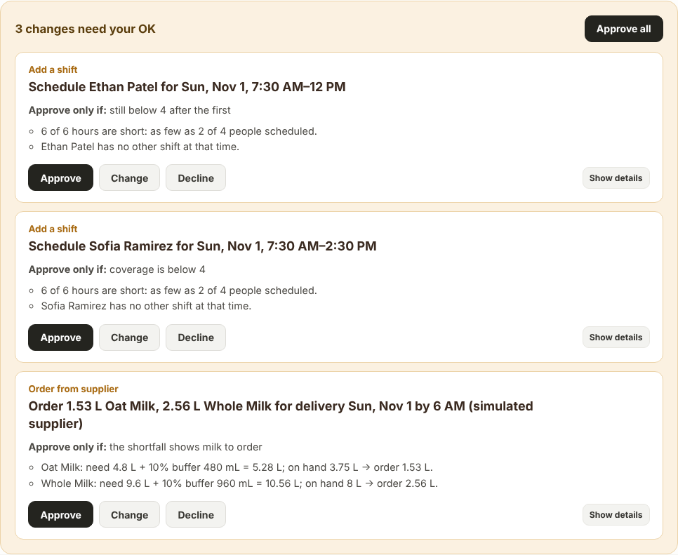
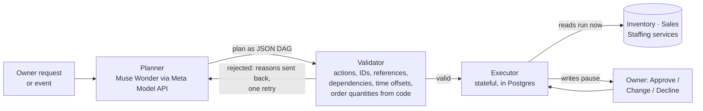

# CaféPilot

AI operations assistant for independent cafés, built for the Meta Global AI Developer Hackathon.
The owner describes what's coming up ("farmers market this Sunday"); Muse Wonder plans the work, code
checks and runs it, and nothing in the café changes until the owner approves.

> **The model proposes, the code decides.** Muse writes the plan. Code validates every step, does all
> the arithmetic, runs the lookups, and pauses every change for the owner's OK.



## How it works



- **Action registry** (`backend/modules/agent/registry.py`): 19 typed actions over the existing
  Inventory, Sales and Staffing services. The model can only use these; `create_sale` and
  `create_employee` are deliberately not exposed.
- **Superset DAG** (`superset.py`): which action may feed which (data edges) and which must come first
  (safety edges, e.g. coverage + staff + existing shifts before scheduling a shift). Checked for cycles
  at startup.
- **Validator** (`validator.py`): rejects unknown actions or IDs, bad arguments, broken `$step.field`
  references, missing prerequisites, another café, wrong UTC offsets for the date (daylight saving),
  supplier orders whose quantities didn't come from `calculate_shortfall`, and staffing checks that
  don't cover the shift being added.
- **Order math in code** (`calculations.py`): need (recipes × expected mix) + buffer (café policy)
  − stock on hand = order. Unknown stock is reported, never guessed; a missing recipe blocks the order.
- **Executor** (`executor.py`): reads run immediately; writes wait at `awaiting_approval`; approval is
  checked again before any write; stable record IDs mean a retry or crash can't create a duplicate;
  replaying a plan never repeats a completed write; owner edits are re-validated and audited.

## Meta models used

Both through the Meta Model API (OpenAI-compatible), with one `MODEL_API_KEY`.

- **Muse Wonder** (`muse-wonder-1.0`, setting `PLANNER_MODEL`): the planner. It turns the owner's
  request or a detected event into the plan, and plans another way when a supplier rejects an order
  or someone declines a shift (`backend/modules/agent/planner.py`).
- **Muse Spark** (`muse-spark-1.3`, setting `VISION_MODEL`): reads images in the delivery check. It
  reads the packing-slip photo (`POST /api/v1/receiving/receipts/{id}/slip`) and counts what it can
  see in the delivery photo (`POST /api/v1/receiving/receipts/{id}/photo`), in
  `backend/modules/receiving/vision.py`. `scripts/try_vision.py` checks this against the demo images.

### Spark vs Wonder for planning

Measured with `scripts/compare_planners.py` on 10 café planning requests (frozen café time, one run per
model per request, `reasoning_effort: high`). Full results:
[`business-core/docs/agentic/planner-benchmark-results.md`](business-core/docs/agentic/planner-benchmark-results.md).

| Model | Valid on the first try | Final outcome (10 requests) | Median first call | Mean total |
|---|---:|---|---:|---:|
| `muse-spark-1.3` | 6 of 10 | 7 plans, 3 clarifying questions | 25.87 s | 27.48 s |
| `muse-wonder-1.0` | 7 of 10 | 7 plans, 3 clarifying questions | 12.25 s | 13.28 s |

One sample per request, so this is not a statistical speed benchmark; a valid plan passed the
validator, which checks structure, not whether the plan is the best one.

## Quick start

Requirements: Docker, Python 3.13, Node 22.

```bash
cd business-core
cp .env.example .env            # set POSTGRES_PASSWORD and MODEL_API_KEY
docker compose up -d            # Postgres on 127.0.0.1:5433
python -m venv .venv && source .venv/bin/activate
pip install -r requirements.txt
./scripts/seed_all.sh           # migrations + demo café data
PYTHONPATH=. python scripts/seed_event_surge.py --fresh   # Sunday farmers-market scenario
# add --with-delivery for the receiving demo (PO-1042 from Willow Ridge, arriving Sun 5:30 AM)
uvicorn backend.main:app --port 8001 --reload
```

In a second terminal:

```bash
cd business-core/frontend
npm install
npm run dev                     # http://localhost:5173/agent
```

Open **Ask CaféPilot** and click **Let's plan ✨** on the Santa Clara Farmers Market.

### After pulling

New code can add database tables (the latest is `ai_calls`, the log behind the bell's AI activity
tab). After every `git pull`, from `business-core` with the virtual environment active:

```bash
alembic upgrade head
```

If the demo dates changed (they moved to Thu Nov 5, 2026 for the Sun Nov 8 market), reload the
sales history and the scenario once:

```bash
PYTHONPATH=. python scripts/seed_sales_history.py --reset && PYTHONPATH=. python scripts/seed_sales_history.py
PYTHONPATH=. python scripts/seed_event_surge.py --fresh
```

### Demo data and timing

All demo data is synthetic. The demo clock is fixed at **Thu Nov 5, 2026, 6 PM** (Pacific; daylight
saving ended Nov 1, so every time is -08:00) and shows as "Demo date" in the sidebar. Upcoming events:
Santa Clara Farmers Market (Sun Nov 8, 8 AM–2 PM, the main scenario), Thanksgiving (Thu Nov 26,
usually quieter) and the Holiday Lights & Craft Fair (Sat Dec 5, usually busier).

Reset the demo data before each run (from `business-core`, with the virtual environment active):

```bash
PYTHONPATH=. python scripts/seed_event_surge.py --fresh                  # farmers-market scenario
PYTHONPATH=. python scripts/seed_event_surge.py --fresh --with-delivery  # plus PO-1042 for receiving
```

This removes the agent's runs and the changes they made (orders, shifts, stock counts), then reloads
the scenario. The server can stay running; refresh the page.

Simulated suppliers answer about 8 seconds after an order is sent. To keep "Waiting on <supplier>"
on screen longer (for a recording), add this to `business-core/.env` and restart uvicorn (`--reload`
doesn't pick up `.env` changes):

```bash
DEMO_SUPPLIER_REPLY_DELAY_SECONDS=30   # extra seconds before a simulated supplier replies (default 0)
```

## Tests

```bash
cd business-core && python -m pytest -q          # needs the Postgres container
cd business-core/frontend && npm test && npx tsc --noEmit
```

CI runs both on every push and pull request (`.github/workflows/business-core.yml`).

## Repository map

| Path | What it is |
|---|---|
| `business-core/backend` | FastAPI app: Inventory, Sales, Staffing modules and the agent |
| `business-core/frontend` | React app: Ask CaféPilot, Dashboard, Inventory, Sales, Staffing |
| `business-core/alembic` | Database migrations |
| `business-core/scripts` | Seed and demo-scenario scripts |
| `business-core/docs` | Module references, agent build plan, demo scenario, screenshots |
| `development-log/` | Day-by-day decisions and results |
| `backend/`, `data/`, `tests/` (root) | Early JSON-file prototype, kept for history; not used by Business Core |

## Status

Built: business data core, agent registry, planner, validator, executor, approvals with
Approve / Change / Decline, the farmers-market scenario, event trigger (Muse finds upcoming events),
the Ask CaféPilot plan graph, supplier-rejection replanning (Muse finds another supplier), the
supplier waiting state (Sent → Waiting for confirmation → Confirmed or Rejected), and receiving
(delivery check with Muse Spark reading the packing slip and the delivery photo).

Next: equipment troubleshooting from Meta glasses photos, and a chat history view.

Demo data is synthetic. The supplier is simulated: orders are confirmed by a stand-in and never add
stock; inventory only increases when goods are actually received and recorded.
