# CaféPilot Phase 1 — Business Core Progress

_Status recorded: October 28, 2026_

## Project overview

CaféPilot Business Core is the operational management application within the existing CaféPilot repository. It provides independent Inventory, Sales, and Staffing backends plus a React management interface for café operators. The current local workspace uses café `CAFE001` and intentionally keeps Business Core separate from Application 1 in the repository root.

## Architecture

- **Backend:** A standalone FastAPI application on port `8001` with versioned Inventory, Sales, and Staffing routers.
- **Modules:** Each business area separates SQLAlchemy models, PostgreSQL repositories, business services, Pydantic schemas, and FastAPI routes.
- **Data:** PostgreSQL is the source of truth. SQLAlchemy uses synchronous sessions, Alembic owns schema migrations, and the local Docker database is exposed on port `5433`.
- **Frontend:** A Vite React/TypeScript application on port `5173` uses React Router, reusable shell and modal components, café-time utilities, section-level API states, and a development proxy from `/api` to Business Core.
- **Isolation:** Application 1 remains independent; Business Core code and infrastructure live under `business-core/`.

## Completion status

| Area | Backend | Frontend |
|---|---|---|
| Inventory | Completed: catalog, physical counts, append-only movements, and read-only stock estimates | Completed MVP: four data views, movement entry, draft count creation, and count verification |
| Sales | Completed: product catalog, variations, modifiers, completed sales, historical snapshots, recipes, ingredient usage, and summary reporting | Completed read-only workspace: overview, history with sale details, and menu products |
| Staffing | Completed: employees, non-overlapping shifts, cancellation, and hourly coverage | Completed MVP: employee creation, shift scheduling and cancellation, date filtering, DST-safe local times, and coverage reporting |
| Dashboard | Uses existing module APIs; no dashboard-specific backend endpoint | Completed operations overview with independent Sales, Inventory, and Staffing sections |

## Functional frontend

The application shell now provides four functional navigation sections:

- **Dashboard:** Historical Sales and Staffing metrics for January 6–12, 2025, plus independently labeled latest-known Inventory estimates.
- **Inventory:** Catalog, physical count, movement, and stock-estimate workflows for `CAFE001`.
- **Sales:** Historical revenue, product performance, hourly distribution, transaction history, and live product catalog.
- **Staffing:** Employee records, scheduled shifts, cancellation, and hourly coverage against an operator-selected threshold.

### Operations dashboard

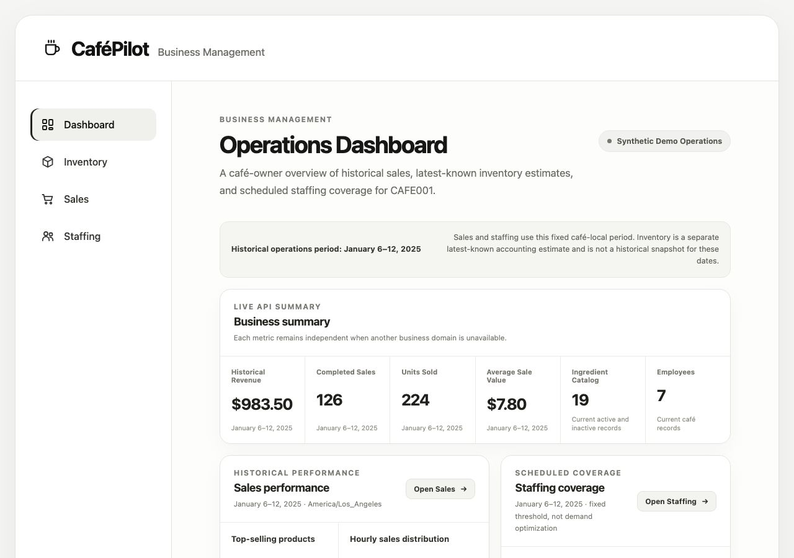

### Inventory overview

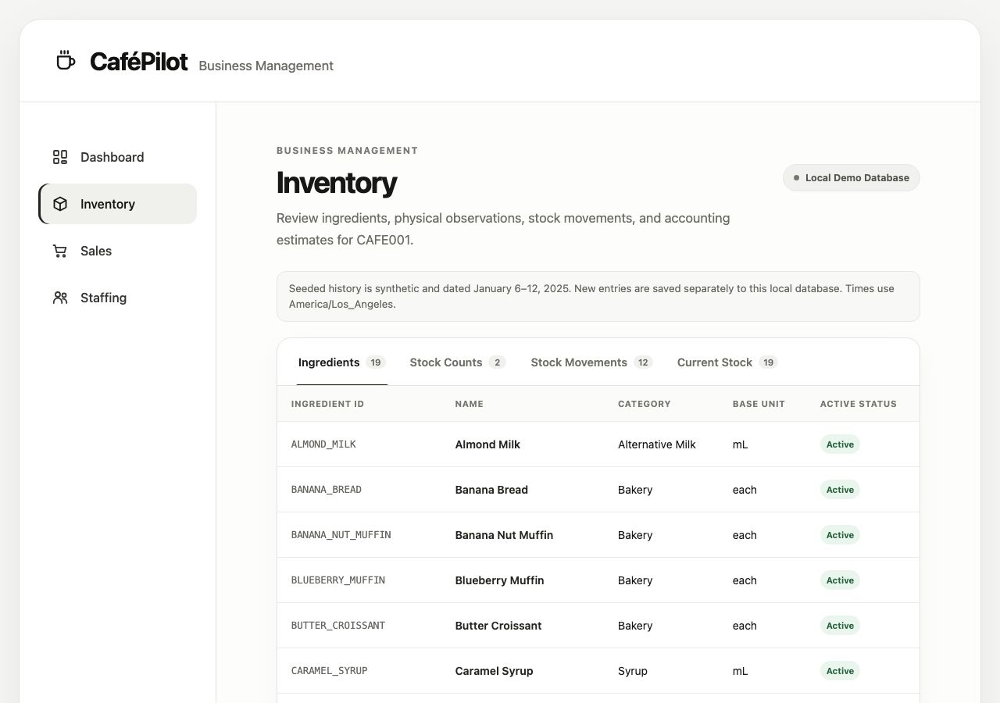

### Sales overview

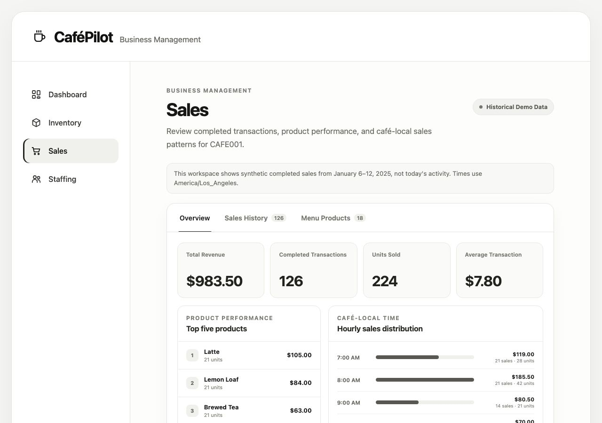

### Staffing overview

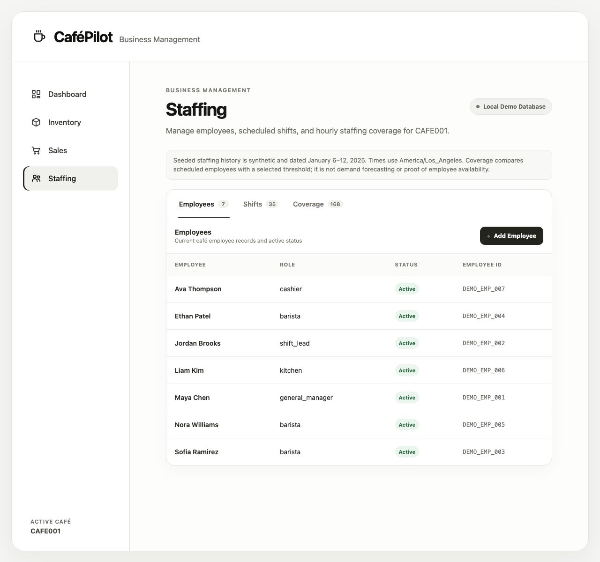

These screenshots show actual API-backed local views at a 1280-pixel desktop width. No operational record was submitted, modified, or cancelled while capturing them.

## Inventory frontend workflows

The Inventory screen reads live Business Core API responses for `CAFE001` and provides:

- Ingredient catalog, stock-count history and details, stock movements, and current-stock estimates.
- Manual Receipt, Waste, and Adjustment entry with backend validation and stable retry identity.
- Multi-ingredient physical counts saved as synthetic drafts without invented quantities or timestamps.
- Explicit verification of draft counts using an operator-provided, timezone-aware observation time.
- Loading, empty, API-error, validation, success, and refresh-warning states.

### Earlier application shell capture

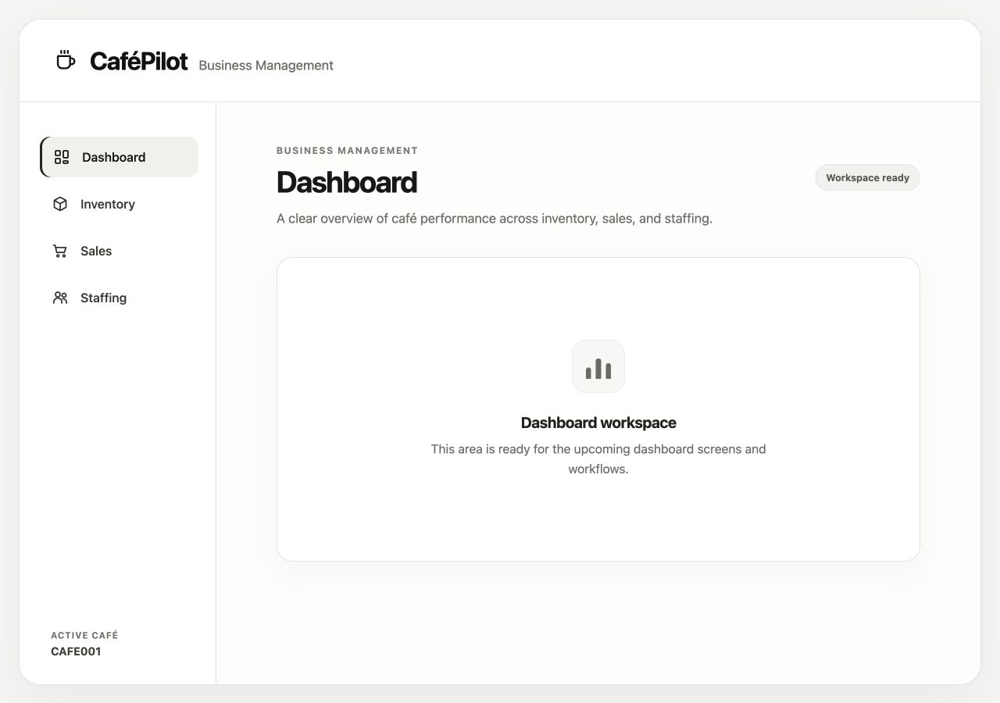

### Inventory data views

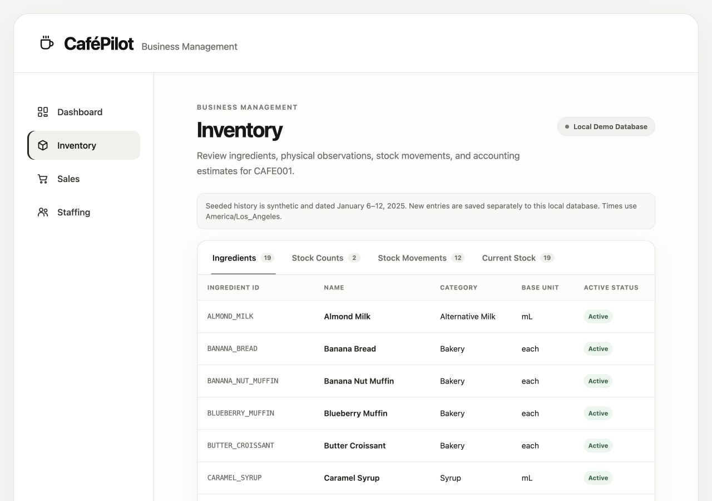

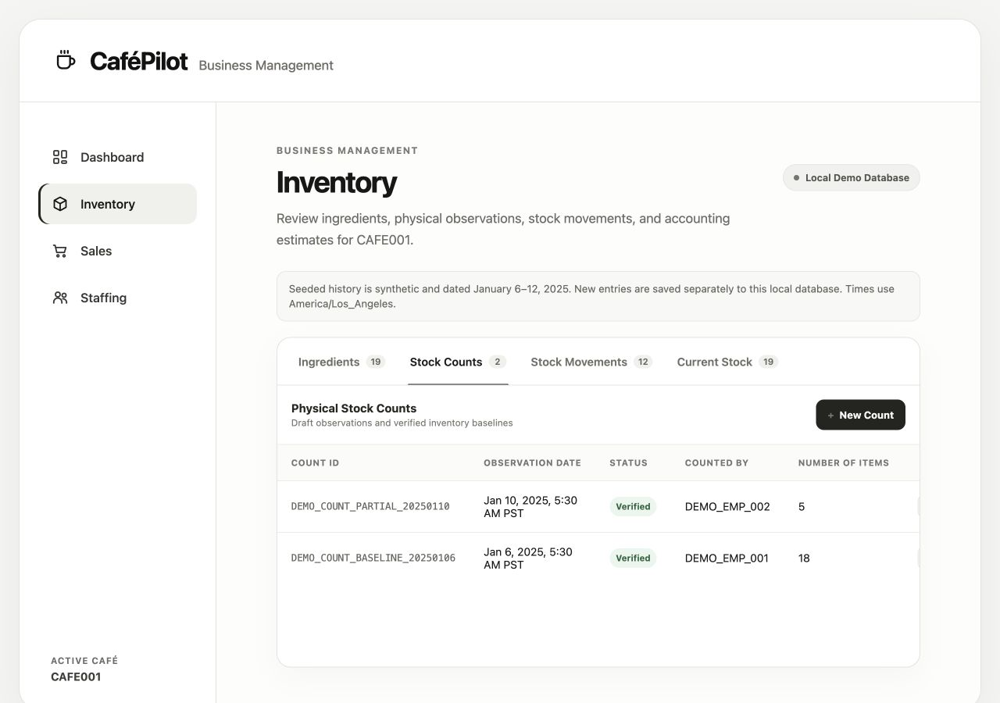

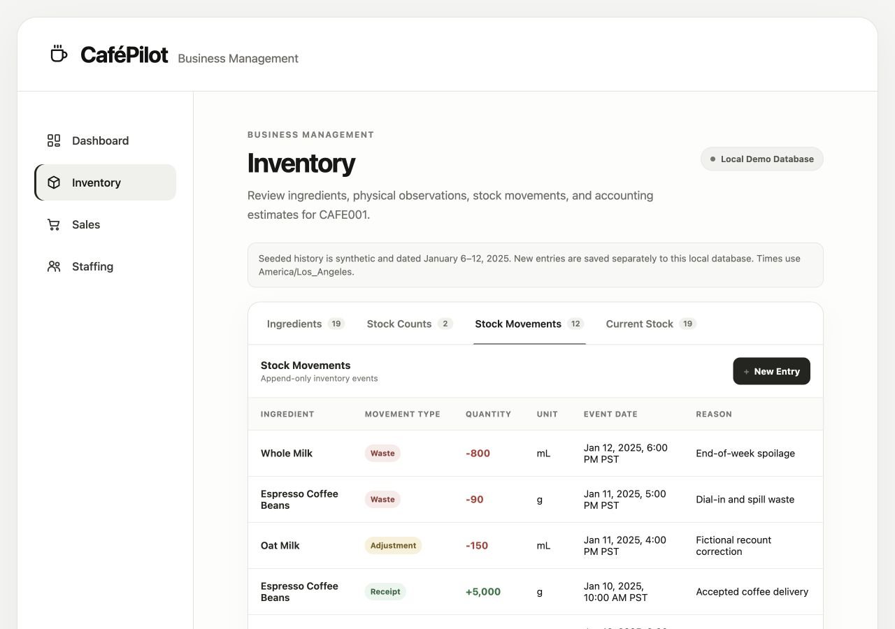

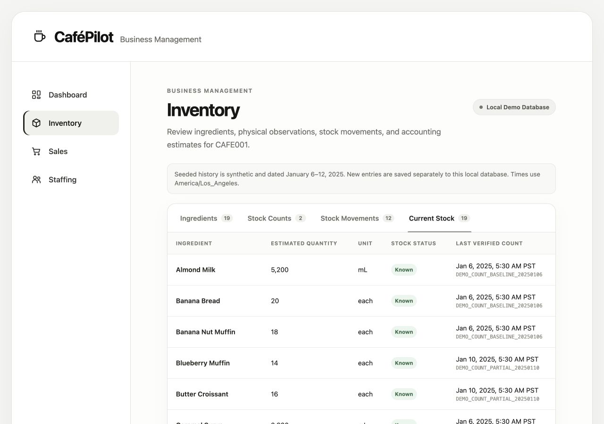

### Inventory entry forms

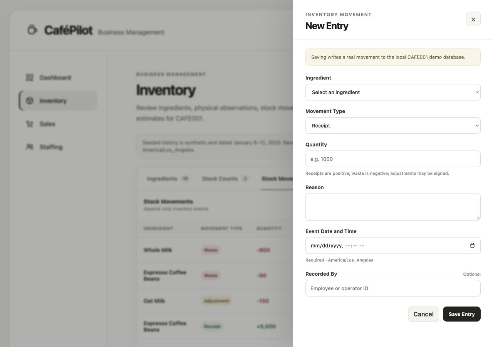

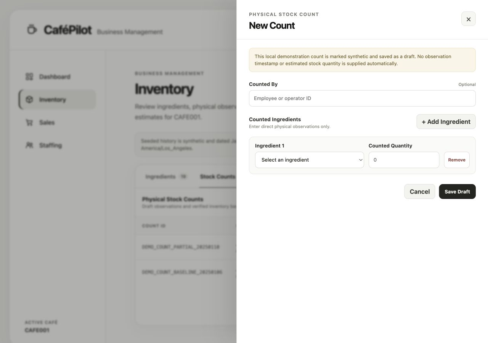

The Inventory screenshots remain the original Phase 1 captures. No operational record was submitted to create them.

## Synthetic demo dataset

The opt-in demo dataset represents operations for `CAFE001` from **January 6–12, 2025** in `America/Los_Angeles`. It is historical synthetic data, not today's activity.

| Table | Confirmed rows |
|---|---:|
| `inventory_items` | 19 |
| `stock_counts` | 2 |
| `inventory_movements` | 12 |
| `menu_products` | 18 |
| `sales` | 126 |
| `sale_items` | 210 |
| `employees` | 7 |
| scheduled `shifts` | 35 |

The dataset includes a partial count, an ingredient with unknown stock, realistic sales variation, and staffing coverage gaps. Sales ingredient usage is computable from recipes, but completed Sales do not automatically deduct Inventory.

## Technical stack

- Python, FastAPI, Pydantic, SQLAlchemy 2.x, Psycopg 3, and Alembic.
- PostgreSQL 17 in Docker Compose.
- React 19, TypeScript 5.9, React Router 7, Vite 7, and Vitest.
- Pytest, HTTPX, Testing Library, and JSDOM.

## Verification

The following checks were **rerun for UI-05**:

| Check | Result |
|---|---|
| Frontend tests | `43 passed` across 5 test files |
| Frontend production build | Passed; TypeScript check and Vite build completed successfully |
| Dashboard API integration | Sales, Inventory, Employees, and Staffing Coverage loaded independently from existing APIs |
| Historical query boundaries | January 6 start and exclusive January 13 end in `America/Los_Angeles` |
| Persistent demo records | `126` sales, `210` sale items, and `35` scheduled shifts remained unchanged |
| Responsive review | Dashboard reviewed at 1280×900 and a true 390×844 browser viewport |
| Screenshot review | Four real functional navigation views captured; no records submitted |

The backend test suite and Alembic checks were not rerun for UI-05 because this milestone contains no backend or schema changes.

## Known limitations

- Authentication and authorization are not implemented; write workflows are internal/local-demo only.
- The Dashboard uses the fixed seeded Sales and Staffing period and does not yet provide arbitrary date-range controls.
- Inventory estimates are accounting estimates, not proof that stock is physically usable or reserved, and they are not a January 2025 historical snapshot.
- The Sales frontend remains read-only; payment, refund, discount, and point-of-sale workflows are not implemented.
- Supplier management, demand forecasting, automated staffing optimization, and owner approval workflows are not implemented.
- Draft stock-count creation, employee creation, and shift scheduling do not have guaranteed idempotent retry contracts. The UI advises operators to inspect existing records after uncertain responses.
- AI, agentic workflows, and MCP integrations have not started.

## Next milestones

1. Review and secure internal write workflows with authentication and authorization.
2. Add dashboard date controls if broader operational periods are required.
3. Define AI and agentic milestones separately after Business Core review.

## References

- [Inventory schema and API reference](../inventory-reference.md)
- [Sales schema and API reference](../sales-reference.md)
- [Staffing schema and API reference](../staffing-reference.md)
