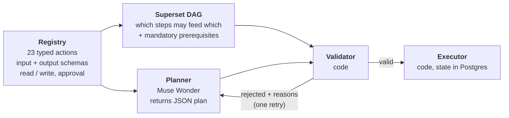
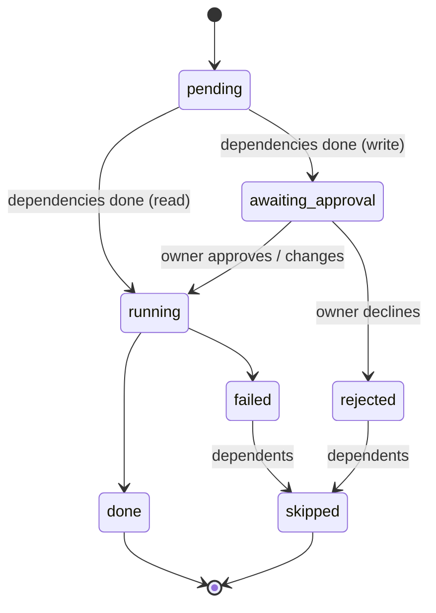
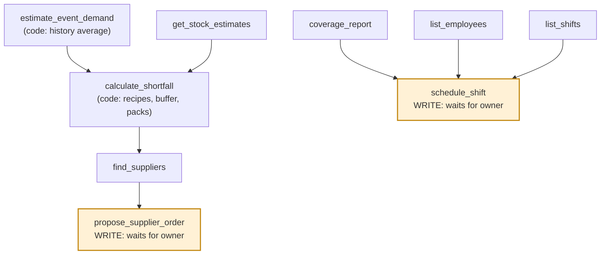

# The planning engine: why a plan graph (DAG), and how it runs

This page explains the design decision at the center of CaféPilot: **Muse does not call our API or
our database. It writes a plan, and code checks and runs it.** It covers why we chose a plan graph
(a DAG: directed acyclic graph), why the model never calls tools itself, and how planning, validation,
execution, approval and replanning work.

## 1. The problem

An owner says something like "The farmers market is Sunday. Are we ready?" Answering takes many steps
that depend on each other:

1. estimate how many extra drinks the market brings,
2. turn drinks into milk, beans and pastries using recipes,
3. compare with stock (and deliveries and normal use until then),
4. round up to supplier pack sizes,
5. find a supplier that can deliver in time,
6. check who is working, find open slots, offer shifts,
7. draft the orders and shifts, and wait for the owner.

Some steps can run in parallel. Some must not run before others (never schedule a shift before
checking coverage; never order a quantity that didn't come from the shortfall calculation). Some change
the real world (orders, shifts) and must wait for a person.

## 2. How the design evolved (and what we learned)

| Stage | Approach | What we saw | Decision |
|---|---|---|---|
| Milestone 4 (Oct 26) | Muse Spark with function calling (`tool_choice="auto"`) | Worked for one example (10 large oat-milk lattes → 1,200 mL oat milk short). But the model *might* skip the tool, and one example doesn't prove reliability. | Keep all calculations in Python. Don't rely on the model choosing to call a tool. |
| Milestone 4A (Oct 26) | Structured extraction → Pydantic validation → Python runs the calculation → grounded answer. Intents: `ready`, `needs_clarification`, `out_of_scope`. | Reliable for one use case. Prompt-requested JSON is not schema-enforced, so output still has to be validated. | Separate *interpretation* (model) from *operations* (code). Validate everything the model returns. |
| AF-02 (Oct 29) | Model writes a **plan graph** of typed actions; code validates the whole plan, runs it step by step, pauses at writes. | Handles multi-step, dependent work, shows the plan to the owner, can't act without approval. | This is the shipped design. |
| Oct 30 | Honest statuses, simulated supplier replies, replanning from facts. | Reviews pointed out that "Done" over-claimed when something was only approved. | *Proposed → Approved → Sent → Waiting → Confirmed / Rejected*. |

## 3. Why a DAG

A plan is a set of steps (nodes) and dependencies (edges). Acyclic means no step depends on itself,
directly or indirectly, so there is always a valid order to run it in.

| Need | How a DAG gives it |
|---|---|
| **Order that matches the real dependencies** | "Estimate demand → calculate shortfall → find suppliers → propose order" is a chain. "Coverage → schedule shift" is another. The two chains are independent and can run side by side. |
| **Validate before anything runs** | The whole graph exists before step 1 executes. Code can reject an unknown action, a missing prerequisite, a reference to a step that doesn't exist, or a cycle, without side effects. A free-running agent loop can only be checked after it has already acted. |
| **Safe pauses** | Reads run immediately. A write step stops at *waiting for you*. Its dependents wait. Nothing sits in memory: the state is in Postgres, so it survives a restart. |
| **Partial failure that makes sense** | If a step fails or the owner declines it, everything downstream is marked *skipped*, and the rest of the graph continues where it can. |
| **Something the owner can read** | The graph is the plan shown in the UI: each step has its reason, its result and a one-line summary written by code. |
| **Replanning is just another plan** | When a supplier rejects an order, code writes a new request from the facts, and the planner makes a new graph linked to the failed one. |

## 4. Why the model does not call our API (or tools) itself

We use three separate ideas, and it helps to keep them apart:

1. **No free tool-calling loop.** The model never decides "I'll call X now" in the middle of a run.
   It returns one JSON plan. Code decides when, whether and with what arguments anything runs.
2. **No HTTP hop.** When the executor runs a step, it calls the domain service method **in process**
   (for example `InventoryService.list_stock_estimates`), not our REST API. The REST API exists for the
   web app.
3. **No raw access.** The model sees only the action registry (names, JSON schemas, mandatory
   predecessors) and a reference-data snapshot of real IDs. `create_sale` (POS-only) and
   `create_employee` (HR-only) are deliberately **not** in the registry.

Why in-process rather than the REST API:

| Reason | Detail |
|---|---|
| **One validation path** | Arguments are checked against the same Pydantic models the services use, before and again after `$ref` values are filled in. |
| **No credentials for the model path** | Nothing on the model path holds a token or can reach an endpoint that isn't registered. |
| **Atomic, idempotent writes** | Write handlers pass stable record IDs (for example `shift_agent_…`, `count_agent_…`), so a retry or a crash can never create a second order or shift. |
| **Fewer failure modes** | No network error, auth error or version drift between the agent and the services. Tests run against a rolled-back database transaction. |
| **Same rules as the UI** | The agent can't do anything the services wouldn't allow a person to do through the app. |

Why not let the model loop on tools (ReAct-style):

| Free tool loop | Plan graph |
|---|---|
| Decides step by step; the full path is unknown until it has run | Whole path known and validated first |
| A bad step may already have happened | Rejected before step 1 |
| Hard to show or audit | Stored as nodes, edges, arguments, results, approvals |
| Approval has to be bolted on | Approval is a node state |
| Output length and cost grow with every loop | One planning call (plus one retry at most) |

We did not add an orchestration framework (LangGraph, LangChain). The graph, validator and executor are
about 1,400 lines of plain Python with `graphlib` and Pydantic, which kept every rule testable.

## 5. The five parts

### 5.1 Action registry (`registry.py`)

The only operations the agent may plan or run. 23 actions, each wrapping an existing service method,
with input and output JSON schemas generated from Pydantic models (never hand-written).

| Area | Actions |
|---|---|
| Inventory (reads) | `list_ingredients`, `get_stock_estimates`, `list_stock_counts`, `get_stock_count`, `list_inventory_movements` |
| Inventory (writes) | `create_stock_count`, `verify_stock_count`, `record_inventory_movement` |
| Sales | `list_products`, `list_sales`, `sales_summary`, `project_recipe_usage` |
| Staffing | `list_employees`, `list_shifts`, `coverage_report`, `schedule_shift` (write), `cancel_shift` (write) |
| Event math (code) | `estimate_event_demand`, `calculate_shortfall` |
| Purchasing | `find_suppliers`, `get_purchase_order`, `list_deliveries`, `propose_supplier_order` (write) |

Every write requires owner approval. Supplier orders are **simulated**: `propose_supplier_order` goes
to a supplier simulator that answers a few seconds after the order is sent.

### 5.2 Superset DAG (`superset.py`)

The rulebook for every dependency a plan may contain. Two kinds of edges:

- **Data edges:** A → B when A *produces* something B *consumes* (computed automatically).
- **Safety edges:** B `requires` A, stated explicitly and mandatory (for example coverage must be checked
  before scheduling a shift).

Data edges say what *may* feed what; safety edges say what *must* come first. The graph is checked for
cycles at import time with `graphlib`.

### 5.3 Planner (`planner.py`)

- The prompt is **built from the registry on every call** (the model is stateless): action names,
  schemas, dependency rules, the output format, and a reference-data snapshot with real IDs, café
  policies and `utc_offset_by_date` for the next two weeks (computed by code).
- The model returns JSON: `status` (`plan`, `needs_clarification` or `out_of_scope`), a goal, and up
  to 15 nodes. Each node has an `id`, an `action`, `args`, a short `reason`, and for writes an
  `only_if` condition the owner confirms.
- Arguments may reference earlier steps with `$s1` or `$s1.items[0].quantity`. **The model does not
  list edges.** Code derives them from the references.
- Planner choice: Muse Wonder 1.0 (see the benchmark in the [README](../README.md#why-muse-wonder-plans)).
  Plans also run from a saved live fixture in tests, so the suite needs no API key.

### 5.4 Validator (`validator.py`)

Nothing the model proposes runs until this passes. The validator never trusts the model's ordering. It
derives edges from `$` references, adds the mandatory safety edges itself, and checks for cycles.

| Rejection code | Meaning |
|---|---|
| `not_a_plan` | Output isn't a usable plan |
| `unknown_action` | An action that isn't in the registry |
| `invalid_args` | Arguments don't match the action's input model |
| `unknown_ref` / `self_ref` | A `$` reference to a step that doesn't exist, or to itself |
| `disallowed_dependency` | A data edge the superset doesn't allow |
| `missing_prerequisite` | A mandatory predecessor is not upstream (for example no coverage check before a shift) |
| `unrelated_prerequisite` | The evidence is for a different shift or time than the write |
| `cafe_mismatch` | A step names a different café |
| `cycle` | The graph is not acyclic |
| `wrong_time_offset` | A timestamp's UTC offset isn't the café's real offset at that moment (daylight saving); the message states the correct value |
| `unverified_quantity` | An order whose lines did not come from `calculate_shortfall.order_lines` |
| `unverified_demand` | Demand written as a literal number when the plan could read it from `estimate_event_demand` |

On rejection the model gets its previous answer plus the reasons and **one retry**. If it still fails,
the owner sees plain reasons and nothing runs.

### 5.5 Executor (`executor.py`)

- A step runs only when everything it depends on is `done`.
- `$` arguments are resolved from upstream results, then **validated again** (the plan was checked
  before values existed).
- **Reads run now. Writes stop at `awaiting_approval`.** The run returns; nothing waits in memory.
- **Approve / Change / Decline.** A change is merged, re-validated and logged. A decline marks the step
  `rejected` and everything downstream `skipped`.
- **Idempotent.** A write whose action and resolved arguments already succeeded is marked done as a
  replay, so running a plan again never places a second order or schedules a second shift. Approval is
  checked again right before the write.
- Step states: `pending → running → done | failed`; writes
  `pending → awaiting_approval → (approved) running → done | rejected → skipped`. Run states:
  `running | awaiting_approval | completed | completed_with_issues`. ("With issues" only when a step
  failed; steps the owner declined show as not needed.)

## 6. Example: the farmers market plan

A simplified version of the graph the planner produces for the demo. Read steps (white) run
immediately; write steps (amber) wait for the owner.

(The real plan may add steps, for example one order per supplier; the validator allows whatever the
superset allows.)

## 7. Replanning

When something goes wrong, code writes the new request **from facts**, not from a summary the model
wrote: who said no, why, what is still needed and by when. The planner starts from that, and the new
run is linked to the failed change.

| Trigger | Result |
|---|---|
| Supplier rejects an order | A new plan with another supplier, e.g. Bay Dairy is out of oat milk → Willow Ridge (tested in `test_agent_replanning.py`) |
| Delivery comes up short | A reorder from another supplier can be planned. Stock only rises by what was received |
| A staff member declines a shift | A replan with another qualified employee |

Replanning on a supplier decline is built and tested, but the current demo data does not trigger it; the
demo shows the short-delivery reorder instead.

## 8. Observability

Every model call goes through `call_model()` (or `call_image()` for Muse Image) and is recorded as an
`ai_calls` row: model, outcome (`ok`, `retried`, timeout, error), attempts, duration. Timeouts and
errors are explained to the owner in plain words and are not retried silently. The Updates bell's
**AI activity** tab shows the log.

## 9. Evidence

- 23 registry actions, with tests that every action has a handler, a schema and a side-effect label,
  and that the superset has no cycles.
- Validator tests for every rejection code and for the saved live plan fixture.
- Executor tests: read-only plan completes; a write stops at awaiting approval *before* it happens;
  failure skips dependents; running twice does no duplicate work; approve twice creates one shift.
- A planner comparison on 10 café requests: Muse Wonder 1.0 and Muse Spark 1.3 both produced 7 plans
  and 3 clarifying questions; Wonder was valid on the first try 7 of 10 times vs 6 of 10, and about twice
  as fast (about 13 s vs 27 s mean). One run per request, so this is not a statistical benchmark. Full
  results: [planner-benchmark-results.md](../business-core/docs/agentic/planner-benchmark-results.md).
