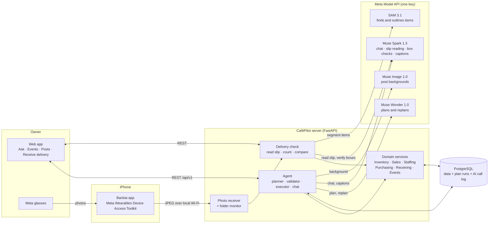
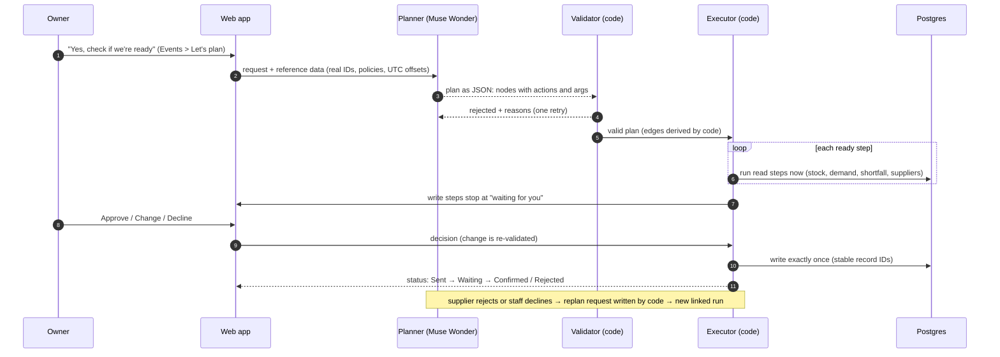
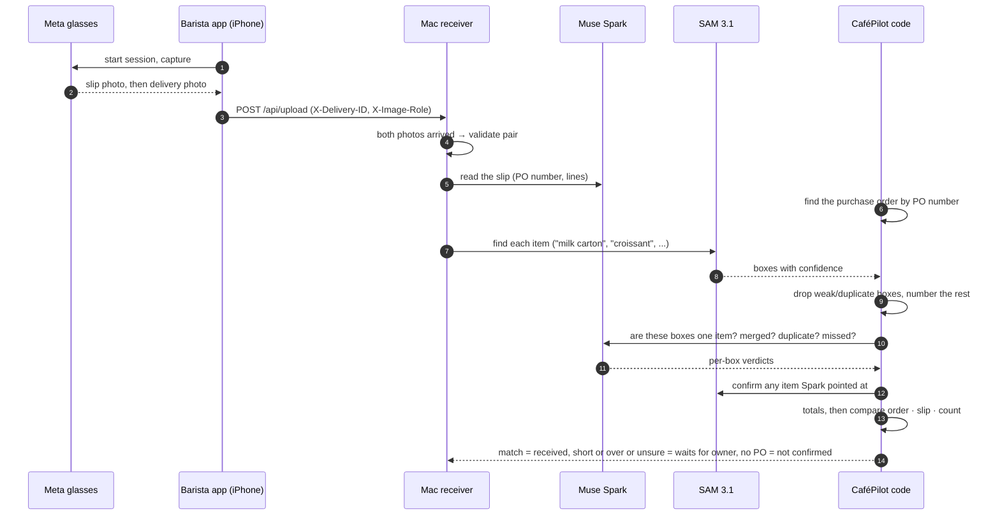

# Architecture

How CaféPilot is put together: the big picture, the pieces, and how one request moves through them.
For the planning engine in depth see [agentic-planning.md](agentic-planning.md); for the numbers see
[forecasting-and-math.md](forecasting-and-math.md); for the glasses app see [mobile-app.md](mobile-app.md).

## 1. The idea in one picture

**The model proposes, the code checks and does the math, the owner decides.** Meta's Muse models
read, plan and talk. Ordinary code owns every number and every write.

## 2. Layers

| Layer | What it does | Where |
|---|---|---|
| **Web app** | React + TypeScript (Vite). Ask (voice or chat), Events, Posts, Dashboard, Inventory, Receive delivery, Sales, Staffing, Updates bell with the AI-activity log. | `business-core/frontend/` |
| **API** | FastAPI under `/api/v1`. Thin: it validates input and calls services. | `business-core/backend/` |
| **Agent** | Turns a request into a plan, validates it, runs it, pauses at writes, replans on failure. Also answers read-only chat. | `backend/modules/agent/` |
| **Domain services** | Inventory, Sales (with recipes), Staffing, Purchasing (simulated suppliers), Receiving, Events. The same services the UI uses. | `backend/modules/*` |
| **Media / receiver** | Accepts photos from the iPhone and starts the delivery check when both photos have arrived. | `backend/modules/media/` |
| **Database** | PostgreSQL with Alembic migrations. Holds business data, plan runs, node runs, approvals and the `ai_calls` log. | `business-core/alembic/` |
| **iOS app** | Swift app that talks to the glasses and ships photos to the receiver. | `BaristaGlassesAgent/` |

Stack: FastAPI, PostgreSQL, Alembic, React/TypeScript/Vite, Swift (iOS), Docker Compose for Postgres,
GitHub Actions CI. The Meta Model API is OpenAI-compatible, so the Python client is the standard SDK
pointed at Meta's base URL with one `MODEL_API_KEY`.

## 3. Who is allowed to do what

| Component | Can read business data | Can write business data | Can produce numbers |
|---|---|---|---|
| Muse models | Only through typed read actions | **Never directly**. They only propose | **No**. Numbers come from code |
| Planner output | n/a | Only as a plan, checked by the validator | No |
| Executor | Yes | Only after the owner approves | Calls the calculators |
| Owner | Yes | Approves, edits or declines every write | n/a |

## 4. One request end to end (event plan)

## 5. Delivery check end to end

Details of the counting rule are in [forecasting-and-math.md](forecasting-and-math.md#7-delivery-counting-and-comparison).

## 6. Data and state

- **Business data** (stock movements and counts, sales with recipes, shifts, purchase orders,
  deliveries, events) lives in PostgreSQL and is changed only through the domain services.
- **Plan runs.** Each plan is stored as a run with nodes (steps), edges, each node's resolved
  arguments and result, and every approval (who, what was edited, which channel). Nothing waits in
  memory, so a restart does not lose a plan.
- **AI call log.** Every model call is one `ai_calls` row: model, outcome, attempts, timing. Rows hold
  a short request summary only: no prompts and nothing that looks like a key. A plan that needed a
  second try is one row with attempts = 2.
- **Honest statuses.** Order and shift changes move through
  *Proposed → Approved → Sent → Waiting → Confirmed / Rejected*. "Done" is only used for something
  that is confirmed.

## 7. Running it

`business-core/scripts/start_demo.sh` starts the API (port 8001), the web app (5173) and the photo
receiver (8004). `--reset` reseeds the demo and `--stop` stops everything. Setup, environment
variables and the demo clock are described in the root [README](../README.md#run-it-locally).
CI (GitHub Actions) runs the backend and frontend tests on every push; the tests use fake model
clients or recorded answers, so CI needs no API key.

## 8. Repository map

| Path | Contents |
|---|---|
| `business-core/backend/modules/agent/` | `registry.py`, `superset.py`, `planner.py`, `validator.py`, `executor.py`, `replanning.py`, `demand.py`, `calculations.py`, `chat.py`, `promo.py`, `ai_calls.py` |
| `business-core/backend/modules/receiving/` | `vision.py` (slip reading), `counting.py` (SAM + Spark count), `service.py` (comparison) |
| `business-core/backend/modules/media/` | photo upload, paired delivery photos, folder monitor |
| `business-core/frontend/` | the web app |
| `BaristaGlassesAgent/` | the iOS companion app |
| `business-core/docs/agentic/` | build plan, demo scenario design, planner benchmark |
| `development-log/` | day-by-day build log |
