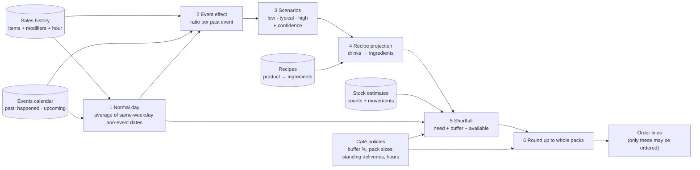

# Forecasting and the math

Every number CaféPilot shows is computed in code from the database. The model never writes a quantity.
This page lists each calculation, its inputs and its limits.

> **What this is, and is not.** Demand estimates are **transparent averages of comparable past days**
> in the café's (synthetic) sales history. They are not a trained or validated forecasting model, and we
> do not report an accuracy score such as MAPE. Where there is little history, the result says so.
> The original design (`CaféPilot — Project Design`) proposed a LightGBM forecast with quantiles and a
> stock "belief" engine; with a 10-day build we shipped the simpler method below because every step of it
> can be shown to the owner and checked by hand.

## 1. How data flows

Code: `demand.py` (steps 1–3), `calculations.py` (4–6), `purchasing/service.py` (`whole_packs`).

## 2. Normal day (baseline)

For the event's date and hours (for example Sunday 8 AM to 2 PM):

> **normal(product) = average quantity sold in that hour window over the most recent same-weekday
> dates with no event, up to 8 dates.**

- Dates with a `happened` event are excluded, so past markets don't inflate the normal day.
- Products are keyed by variation and milk choice (for example a large latte with oat milk).
- If there is no usable history for that weekday, the result says so and the normal day is zero.

## 3. Event effect

For each **past event of the same kind** (past editions of the *same named* event are preferred;
otherwise events of the same type) that ended before the "as of" time:

1. `actual` = what sold in that past event's window.
2. `expected` = the normal day for that past date and window (step 2, applied to that date).
3. For each product group (menu category × milk group), the ratio is smoothed so small groups don't
   swing wildly:

   > **ratio = (actual + 3) / (expected + 3)**

4. Apply it to the upcoming normal day: **extra(product) = normal(product) × (ratio − 1)**.

That gives one estimate of the extra demand per past event.

**Illustration (made-up numbers).** A past market sold 90 drinks in a window where a normal day sells 60:
ratio = (90 + 3) / (60 + 3) = 1.476. If the upcoming normal window is 64 drinks, the extra demand is
64 × 0.476 ≈ **30 drinks**.

## 4. Scenarios and confidence

For each product group, take the effects seen across the past events:

| Scenario | Value used |
|---|---|
| **low** | the lowest ratio (about the 20th percentile once there are 5 or more examples) |
| **typical** | the middle ratio |
| **high** | the highest ratio (about the 80th percentile once there are 5 or more examples) |

Because each group moves from low to high together, every ingredient moves in the same direction.

**Rounding that adds up.** Quantities are rounded with largest-remainder apportionment per category, so
the rounded rows still sum to the rounded total (no "63 + 63 + 63 ≠ 190" surprises).

**Confidence** is plain and shown to the owner:

| Past examples | Confidence | What the app says |
|---|---|---|
| 3 or more | `good` | estimate shown with the examples behind it |
| 1 or 2 | `rough` | "Only 1 past edition: treat as a rough guide." |
| 0 | `none` | "No past events in the history: showing a normal day only." |

The result also lists each example (event, date, extra drinks implied) and the baseline rule
("average of the last N Sundays without events, 8 AM to 2 PM"), so the owner can see where it came from.

## 5. From drinks to ingredients to an order

**Recipe projection.** The chosen scenario's items (for example "+28 lattes, +6 croissants") go through
the café's recipes to get ingredient quantities. If any item has no recipe the calculation **fails
closed**: no order is produced, because an incomplete recipe would understate every total.

**Shortfall** (`calculate_shortfall`), per ingredient:

> needed = recipe quantity for the extra demand
> buffer = needed × buffer % (café policy, default 10 %)
> target = needed + buffer
> available = on hand + deliveries expected before the cover-until time − normal use until then
> shortfall = target − available
> status: **enough** if available ≥ target; **short** otherwise; **unknown_stock** if stock isn't known

- Normal use comes from step 2 (same weekday and hours, no events). Standing deliveries come from the
  café's delivery rules. The cover-until time defaults to closing time on the event day.
- **Unknown stock is reported, never treated as zero, and never ordered blind.**

**Packs.** Orders are rounded **up** to whole supplier packs, and the quantity the owner approves is the
quantity that is sent.

> packs = ceil(shortfall / pack size) · order quantity = packs × pack size

**Illustration (made-up numbers).** Whole milk comes in half-gallon (1,890 mL) packs. Needed 8,000 mL,
buffer 10 % = 800 mL → target 8,800 mL. On hand 3,000 mL, no deliveries, normal use 2,500 mL →
available 500 mL. Shortfall 8,300 mL → ceil(8,300 / 1,890) = 5 packs → order **9,450 mL**.

**Supplier choice.** `find_suppliers` compares suppliers by whether they carry every line, total price
and whether they can deliver before the deadline (for example before opening). Suppliers and their
answers are **simulated** in the demo.

## 6. Staffing math

Staffing gaps are computed in code too. The café policy says how many staff a normal day needs and how
many a busy event needs (for example 2 normal, 4 for a market). `coverage_report` compares scheduled
shifts hour by hour, and the open slots become `schedule_shift` offers for qualified employees. The validator requires the right checks (such as the coverage report) to come
before a shift can be offered.

## 7. Delivery counting and comparison

For each kind of item on the order:

1. **SAM 3.1** finds every item for a short noun phrase code picks ("milk carton", "croissant", "bag
   of coffee"). Similar-looking items share a phrase and Spark says which product each box is.
2. **Code** drops weak boxes (SAM confidence below 0.5) and duplicates (two boxes with an IoU of 0.7
   or more are one item), numbers the rest, and flags boxes unusually big or small compared with the
   median (area above 1.8× or below 0.35×: maybe two merged items or a fragment). A box that SAM gives
   no confidence score is kept and counted as sure.
3. **Muse Spark** checks the numbered boxes: one item? two merged? not an item? a duplicate? which
   product? And it points at items with no box.
4. **SAM** confirms each pointed-at spot; only a new, confident box counts.
5. **Code** adds up the totals. The count is **confident** only if SAM and Spark agree and SAM is sure
   (every counted box is at least 0.8 confidence and holds one item, Spark found nothing SAM missed, and
   Spark only threw out boxes SAM itself was unsure of).

**Comparison** (`receiving/service.py`): code compares the order, the slip and the count and flags
each line as match, needs count, short, short-shipped, over, not on order, missing or damaged.

| Result | What happens |
|---|---|
| Every line matches and the count is confident | Delivery is confirmed automatically, stock goes up by the counted amount, the order is marked Delivered |
| Short, over, damaged or unsure | Nothing changes in stock. The check waits for the owner's count or OK; accepted quantities become stock, shortfalls become a credit request or a reorder |
| PO not found | Everything is read and counted, nothing is confirmed, "order not found" is logged |

An uncertain count is shown as **"may hide more → please count it"**, never as a short delivery.

## 8. Honest limits

- Demand is an average of comparable past days in **synthetic** history. It is not a trained model, has
  no accuracy score, and is only as good as the examples. With few past events it says "rough" or "none".
- The estimate does not model weather, price changes or promotions.
- Suppliers' prices, stock-outs and replies are simulated.
- Counting can still be wrong when items are stacked or hidden; that is why an uncertain count asks a
  person instead of guessing.
- Slip reading can misread digits (we saw a slip number misread in testing). Matching uses the **PO
  number found by code**, and the owner sees the slip and order side by side.
- Tests check the math on fixtures; they do not prove live-model accuracy.
