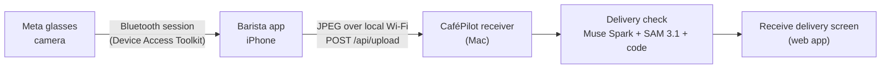

# The Barista app: Meta glasses to CaféPilot

`BaristaGlassesAgent/` is a small SwiftUI iPhone app (displayed on the phone as **Barista**) that
connects to Meta glasses and gets the delivery photos to CaféPilot. This page covers why it exists, how
it works, the owner's flow, the problems we ran into, and what the platform did not give us.

References we built from:
[Meta Wearables Device Access Toolkit docs](https://wearables.developer.meta.com/docs/getting-started-toolkit) ·
[iOS SDK (`meta-wearables-dat-ios`)](https://github.com/facebook/meta-wearables-dat-ios) ·
[iOS integration](https://wearables.developer.meta.com/docs/develop/dat/build-integration-ios/) ·
[session lifecycle](https://wearables.developer.meta.com/docs/develop/dat/lifecycle-events/) ·
[MockDeviceKit](https://wearables.developer.meta.com/docs/develop/dat/testing-mdk-ios/)

## 1. Why a phone app at all

At 6 AM a café owner is carrying crates. A delivery check by hand means a clipboard, a packing slip and
counting by eye. Meta glasses leave both hands free, but glasses cannot talk to our server on their own:
the Wearables Device Access Toolkit gives an **iPhone app** access to the glasses (session, camera
stream, photo capture). So the phone is the bridge:

The app does one thing for CaféPilot: **capture two photos (the packing slip, then the delivery) and
send them**. It never validates anything itself. The Mac does that once both photos have arrived, and
the owner sees the result in the web app.

## 2. The flow for the owner

1. Wear the glasses, open Barista, and tap **Start Glasses Session** (the checklist shows what's ready).
2. Tap **Start Delivery Check**. Look at the packing slip and capture it. Barista tags it as the
   **receipt** and automatically switches to the **delivery** photo.
3. Look at the delivered goods and capture them.
4. Both photos sync to the Mac. The Mac reads the slip, finds the order by its PO number, counts the
   delivery and compares everything. A clean match confirms itself; anything short, over, damaged or
   unsure waits for the owner.

## 3. How it works

| Part | Detail |
|---|---|
| **Glasses session** | `CameraManager.swift` uses the Device Access Toolkit: register with the Meta AI app, request camera permission, start a session, show a preview, capture a photo. `StartupDiagnostics.swift` powers the readiness checklist. |
| **Local storage** | Every JPEG is saved on the iPhone in `Documents/Photos` first, so a failed upload never loses a photo. |
| **Discovery** | `LocalPhotoSyncManager.swift` finds the Mac receiver over **Bonjour** (`_baristaphoto._tcp`) on the same Wi-Fi. No IP address typed, no router ports opened, no cloud bucket. |
| **Upload** | `POST /api/upload`: raw JPEG body with `Authorization: Bearer <PHOTO_SYNC_TOKEN>`, `X-Capture-ID`, `X-Captured-At`. Delivery-check photos also send `X-Delivery-ID` and `X-Image-Role: receipt \| delivery`. |
| **Queue and retry** | Photos queue on the phone and retry when the receiver is available. Capture IDs make uploads idempotent. |
| **Pairing** | The Mac keeps a manifest per delivery ID. When both roles have arrived, its folder monitor calls `POST /api/receiving/validate-pair`. |
| **Result** | See [architecture.md](architecture.md#5-delivery-check-end-to-end) and [forecasting-and-math.md](forecasting-and-math.md#7-delivery-counting-and-comparison). |

Secrets: the team ID and the sync token are read from `Configuration/Local.xcconfig`, which is ignored
by Git. `Local.xcconfig.example` shows the shape. Nothing secret is committed.

## 4. Testing it without glasses

- The **simulator uses Meta's MockDeviceKit** by default and shows an orange MOCK GLASSES banner. The
  physical iPhone uses real glasses. Launch arguments `--use-mock-glasses` / `--use-real-glasses`
  override it.
- `python3 Scripts/test-stage2.py` builds and installs the simulator app and runs **ten SDK checks**:
  configuration, pre-registration gating, registration, denied permission, granting permission,
  duplicate-start protection, pause retention, resume, disconnect/reconnect, and foreground/background.
- A mock success is **not** proof of hardware connectivity, and the README says so. What was and was not
  confirmed on real hardware is listed in the app README's "Current confidence" section.
- Without glasses at all, the web app's built-in sample order **PO-1042** comes with demo photos so the
  delivery check can still be shown.

## 5. Challenges and what we did about them

| # | Challenge | What we did |
|---|---|---|
| 1 | **Signing and the Wi-Fi entitlement.** A free Apple Personal Team cannot provision the *Hotspot Configuration* entitlement the glasses' Wi-Fi camera transport needs. Signing fails if it is enabled. | Debug builds use `BluetoothOnly.entitlements` and label themselves Bluetooth-only. The full entitlement stays in the project for a team that can provision it (`WIFI_STREAMING_CONFIGURED`). |
| 2 | **Mock vs real.** The simulator can pass every check without a pair of glasses in sight. | MockDeviceKit is clearly bannered; ten repeatable SDK checks; hardware behavior is tracked separately in the README's "confidence" list. |
| 3 | **Session lifecycle.** Backgrounding the app ends the session; a paused session waits for the glasses to resume; folded or disconnected glasses need a new session. | The app never silently replaces a session. It shows the state, and the owner starts a new one explicitly. A readiness checklist makes the current state obvious. |
| 4 | **Registration and permissions.** Registration and camera permission are approved in the Meta AI app, glasses must be in Developer Mode, and the callback uses a custom URL scheme. | Step-by-step manual setup in `BaristaGlassesAgent/README.md`; checklist items go green and stay green once granted; *Refresh* rechecks. |
| 5 | **Getting photos off the phone.** We started with an upload to a backend URL (needing a token and a tunnel), then moved to local-only recordings, and ended with photos synced straight to the Mac over local Wi-Fi. | Bonjour discovery + bearer token + queue and retry. No cloud, no port forwarding. |
| 6 | **Two photos, one check.** A delivery needs the slip *and* the goods, and the order isn't known when you take the photos. | `X-Delivery-ID` + `X-Image-Role` pair the photos; the Mac finds the order from the **PO number on the slip**, so nobody types an order number. One delivery check per order. |
| 7 | **Scope: video.** The design called for a 15-second clip and tracking items across frames. We built clip recording (Stage 4), but counting from video was a design risk. | We use a **single photo**, SAM boxes and Spark verification instead of video tracking. Recording stays local on the phone. |
| 8 | **Counting accuracy.** SAM can merge or miss stacked items, and Spark alone can miscount. | Two-model check plus code totals; uncertain counts say "please count it", never "short". See the math doc. |
| 9 | **Slip reading.** Muse can misread a digit (we saw a slip number misread in testing). | Matching uses the PO number as code finds it, the owner sees slip and order together, and nothing is confirmed unless every line matches and the count is sure. |
| 10 | **Secrets in a public repo.** The repo is public. | Team ID and token live in an ignored `Local.xcconfig`; `.gitignore` covers it. |

## 6. What the platform did not give us (and what we did instead)

| We wanted | What was available | What we did |
|---|---|---|
| Hands-free voice on the glasses ("check delivery", spoken results in the ear) | The toolkit gave us session, camera stream and photo capture. We did not use voice, speech or input events. | The owner starts the check on the phone; results appear on the web app. Voice lives in the web app's Ask tab. |
| Meta voice transcription and text-to-speech | Muse Voice Transcribe is not used in the final app; the design notes say Meta has no text-to-speech model. | The Ask tab uses the browser's speech recognition and text-to-speech. |
| Glasses talking straight to our server | Glasses talk to the phone app, not to the network on their own. | The Barista app is the bridge. |
| Glasses Wi-Fi camera stream on any developer account | Needs an entitlement that a Personal Team can't provision. | Bluetooth-only Debug build for development. |
| Production-grade device registration | We used Developer Mode with a custom callback scheme (`META_APP_ID = 0`, empty client token). | Documented as the Developer Mode path; production would need a real Meta app ID and client token. |
| Counting from video | SAM 3.1 is used on a still photo; we did not rely on video tracking. | Single photo + Spark box verification. |

## 7. Honest status

- **Verified** (README checkpoints): simulator build and all ten SDK mock checks; signed Bluetooth-only
  Debug device build and install on an iPhone; file-sharing setup; a synthetic MP4 recorder check.
  Photo sync and paired validation are described in the app README and covered by the backend tests.
- **Developer Mode only.** The app is a hackathon demo, not an attested production integration.
- **Local network only.** Photos go from the phone to a Mac on the same non-guest Wi-Fi.
- All cafés, suppliers, orders and documents shown are fictional.
